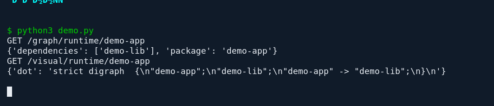
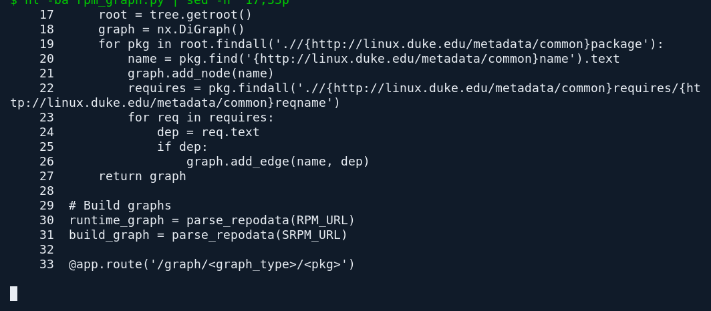

# Граф зависимостей OpenScaler

Сервис задуман для анализа зависимостей пакетов OpenScaler. Из метаданных RPM и SRPM строятся два графа NetworkX. Маршрут /graph возвращает зависимости, /visual — описание подграфа в формате DOT.



*Ответы двух маршрутов на синтетических данных*



*Фрагмент разбора метаданных из конкурсной версии*

## Запуск

Требуются Python 3 и доступные gzip-файлы метаданных. Адреса RPM_URL и SRPM_URL задаются в rpm_graph.py.

```bash
python3 -m pip install flask networkx requests pydot
python3 rpm_graph.py
```

## Что проверено

Оба маршрута вызваны через тестовый клиент Flask на небольшом XML в формате, который ожидает парсер. Встроенный URL runtime-метаданных вернул 404. Разборщик ожидает элементы requires/reqname, а для стандартных RPM-метаданных потребуется обработка rpm:entry. Конкурсный test_graph.py обращается к неопределённой переменной graph.

## Авторство

Вячеслав Георгиевич Кузнецов. Сбертех, задание 1.
